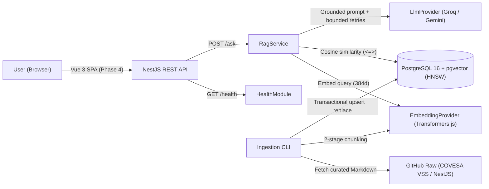

# EngiRAG Architecture Overview

> Status: **Phases 1–3** completed (Infrastructure + Document Ingestion + Retrieval, LLM & `POST /ask` API). Phases 4–5 will add the Vue 3 SPA and retrieval evaluation benchmarks.

## System Architecture

## Phase 1 Infrastructure Decisions

1. **Direct SQL via `pg` instead of an ORM**: Keeps vector operators (`<=>`), HNSW index definitions, and transactional batch operations transparent and inspectable.
2. **Startup validation with Zod**: `validateEnv` validates all configuration keys at boot and surfaces field-level errors without exposing secret values.
3. **pgvector HNSW index (`vector_cosine_ops`)**: Supports incremental document ingestion without requiring an upfront training step (unlike IVFFlat), while offering fast approximate nearest-neighbor search.

## Phase 2 Ingestion & Embedding Decisions

1. **`@huggingface/transformers` (`^4.3.2`) with `Xenova/all-MiniLM-L6-v2`**: Runs locally on CPU via ONNX Runtime (`transformers.node.cjs`), producing 384-dimensional L2-normalized vectors with zero API cost and full CommonJS compatibility inside NestJS.
2. **Two-Stage Heading-Aware Chunking**: First splits Markdown along heading boundaries while preserving heading hierarchy and section anchors (ignoring `#` inside code fences); second splits oversized sections along paragraph/sentence boundaries with overlap so unrelated topics never bleed together.
3. **Content-Hash Idempotency + Transactional Chunk Replacement**: Computes a SHA-256 hash across raw Markdown, chunk size, overlap, and embedding model name; unchanged documents are skipped, and updated documents delete prior chunks before inserting replacements inside a single PostgreSQL transaction.

## Phase 3 Retrieval, LLM & RAG Decisions

1. **Threshold + Top-K Cosine Retrieval (`1 - (embedding <=> $1::vector)`)**: Filtering by `RETRIEVAL_MIN_SCORE` prevents unrelated queries from forcing low-relevance passages into the LLM context window.
2. **Provider Abstraction & Bounded Backoff**: `LlmProvider` isolates Groq (`openai` SDK + custom `baseURL`) and optional Gemini REST integration behind one interface, with `withBoundedRetry` enforcing exponential backoff (`maxRetries=3`) on `429`/`502`/`503`/`504` and strict `20s` request timeouts.
3. **Citation Validation as Guardrail (Not Proof)**: `validateAndSanitizeCitations` removes out-of-range `[n]` markers and rejects completely uncited answers, while returning retrieved excerpts and source URLs separately so users can verify claims directly.
