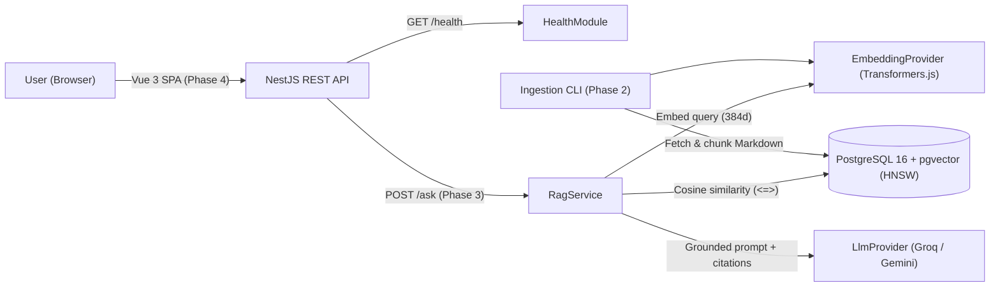

# EngiRAG Architecture Overview

> Status: **Phase 1 (Foundation)** completed. Phases 2–5 will add document ingestion, pgvector retrieval, LLM grounding, Vue 3 UI, and retrieval evaluation.

## System Architecture

## Phase 1 Infrastructure Decisions

1. **Direct SQL via `pg` instead of an ORM**: Keeps vector operators (`<=>`), HNSW index definitions, and transactional batch operations transparent and inspectable.
2. **Startup validation with Zod**: `validateEnv` validates all configuration keys at boot and surfaces field-level errors without exposing secret values.
3. **pgvector HNSW index (`vector_cosine_ops`)**: Supports incremental document ingestion without requiring an upfront training step (unlike IVFFlat), while offering fast approximate nearest-neighbor search.
